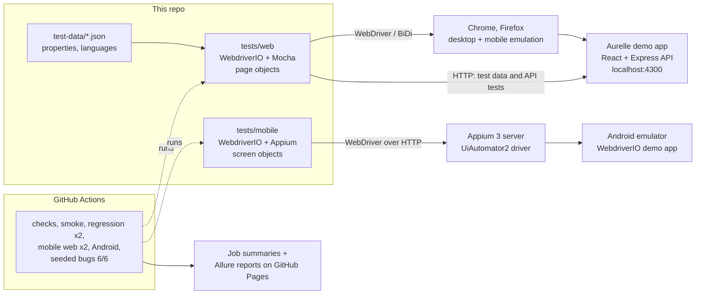

# Concierge QA

[](https://github.com/adilet0212/concierge-qa/actions/workflows/ci.yml)
[](https://adilet0212.github.io/concierge-qa/)

**One WebdriverIO + Appium framework that tests a hotel guest app on desktop web, mobile web and
native Android, and proves it catches real regressions.**

The app under test is **Aurelle Hotels & Resorts, a fictional demo** built for this project. It is
modelled on the flows a luxury hotel guest app has: sign-in with a one-time code, room booking,
in-room dining, guest requests, concierge chat, five properties in different time zones and
currencies, and three languages. It can also switch on six realistic bugs, so the suite can show it
finds them.

## Why this matters for a hotel guest-experience QA team

- **One framework for web, mobile web and native.** The same TypeScript, runner, reports and CI
  cover Chrome and Firefox, iPhone-size and Pixel-size mobile web, and an Android app through Appium.
- **Built to scale across properties and languages.** Properties and languages are JSON. Tests loop
  over them, so a new hotel or language is a one-line change that adds every combination
  (5 properties x 3 languages = 15 matrix tests today).
- **Accessibility gate.** axe-core scans ten key screens and fails the build on serious or critical
  WCAG 2.1 AA violations.
- **Proven catch rate.** CI runs the suite against a build with six seeded regressions (wrong service
  charge, check-out on the check-in day, wrong time zone, missing translation, double order, short
  sign-in code) and passes only when **6/6** are caught.
- **Fast feedback, readable results.** A one-minute smoke suite gates the full runs. Every CI job writes
  a passed / failed / flaky / time table to the GitHub job summary, and Allure reports with screenshots
  are published to GitHub Pages.
- **Flaky tests are visible, not hidden.** Failed tests retry once, and a test that passes only on the
  retry is reported as **FLAKY**.

## Architecture



## Quick start

You need **Node.js 22.12+** and **Chrome**.

```bash
npm install
npm run app          # builds and starts the demo app on http://localhost:4300 (leave it running)
npm run test:smoke   # in a second terminal
```

Open http://localhost:4300 to try the app yourself. Sign in with any email; the one-time code
appears in the dev inbox panel on the page.

## Running each suite

Start the app first (`npm run app`) for every web suite.

| Command | What it runs |
|---|---|
| `npm run test:smoke` | 6 critical-path tests on Chrome (about 1 minute) |
| `npm run test:regression` | All 71 web tests on Chrome, 5 in parallel |
| `npm run test:firefox` | All 71 web tests on Firefox |
| `npm run test:mobile-web` | The smoke tests on an iPhone-size and a Pixel-size phone (Chrome mobile emulation) |
| `npm run app:bugs`, then `npm run test:seeded-bugs` | The app with all six seeded bugs on, then the regression suite; prints the catch-rate table and passes only at 6/6 |
| `npm run mobile:download-app`, then `npm run test:mobile` | The Appium suite (9 tests) on an Android emulator; see [docs/MOBILE_SETUP.md](docs/MOBILE_SETUP.md) |
| `npm run report:summary` | The passed / failed / flaky table for the last run |
| `npm run report:allure` | Builds and opens the Allure HTML report for the last run |
| `npm run typecheck`, `npm run lint`, `npm run lint:locales` | Strict TypeScript, ESLint (bans `browser.pause`), translation key parity |
| `npm run bug-hunt -- js-08`, `npm run bug-hunt:verify` | The [bug-hunt practice pack](practice/bug-hunt/README.md) |

Useful options (environment variables): `HEADED=true` to watch the browser, `BROWSER=firefox`,
`MAX_INSTANCES=2` to run fewer browsers at once, `MOBILE_PROFILE=iphone|pixel`, `BASE_URL`.
They work on every OS through cross-env, e.g. `npx cross-env HEADED=true npm run test:smoke`.

## Test reports

- **Live Allure reports:** https://adilet0212.github.io/concierge-qa/ (one report per suite, from the
  latest run on `main`)
- **CI runs and job summaries:** [GitHub Actions](https://github.com/adilet0212/concierge-qa/actions/workflows/ci.yml)

## What is tested

| Area | Tests | Highlights |
|---|---|---|
| Sign-in | 5 | One-time code, wrong code, expired code, session survives reload, sign-out ends the server session |
| Room booking | 14 | Happy path, no check-out on check-in day, no past dates, guest limits, price maths and local check-in time for every property |
| In-room dining | 8 | Bill per property (tax and service charge rates), double-click creates one order, live order status |
| Guest requests and chat | 2 | Request status timeline updated by staff, concierge auto-reply |
| Localization | 9 | Every language: translated sign-in and confirmation, no raw keys on key screens |
| Property x language matrix | 15 | Local time, currency and translations for every combination |
| Accessibility | 10 | axe-core, WCAG 2.1 AA, serious/critical violations fail |
| API | 8 | Status codes, contract, validation, permissions, idempotency |
| **Native Android (Appium)** | 9 | Login and sign-up validation, native alerts, forms, swipe, navigation, WebView |

The Spa feature is deliberately untested: it's an exercise in [docs/MAKE_IT_YOURS.md](docs/MAKE_IT_YOURS.md).

## The six seeded regressions

All toggles live in one file, [`app/shared/seeded-bugs.ts`](app/shared/seeded-bugs.ts), and every changed
line is marked `SEEDED BUG #n`. Full bug reports: [docs/BUG_REPORTS.md](docs/BUG_REPORTS.md).

| # | Regression | Caught by |
|---|---|---|
| 1 | Dining service charge calculated on subtotal + tax | Dining bill tests (every property) |
| 2 | Check-out allowed on the check-in date (0-night stay) | Date picker UI test and API validation test |
| 3 | Reservation shown in the browser's time zone, not the hotel's | Local check-in time tests |
| 4 | Missing French translation shows `booking.confirm.title` | Localization tests |
| 5 | Double-clicking "Place order" creates two orders | Double-click test |
| 6 | Sign-in code field accepts 5 digits, server sends 6 | Sign-in smoke test |

## Project layout

```
app/                 demo guest app: Express API + React web app, seeded-bug toggles
tests/web/           WebdriverIO web suite: pageobjects/, specs/, support/, configs
tests/mobile/        WebdriverIO + Appium suite: screens/, specs/, config
test-data/           properties, languages, seeded-bug map (JSON)
scripts/             CI helpers: job summaries, catch-rate report, Pages index, APK download
.github/workflows/   ci.yml (every push and PR), android.yml (main and on demand)
practice/bug-hunt/   "find the bug" exercises with tests, answers and solutions
docs/                strategy, bug reports, study guide, exercises, mobile setup
```

## Documentation

- [Test strategy](docs/TEST_STRATEGY.md): risks, what to automate, device matrix, release criteria
- [Bug reports](docs/BUG_REPORTS.md): the six seeded regressions, written up as a QA engineer would
- [Study guide](docs/LEARN.md): how WebdriverIO and Appium work, design choices, likely questions
- [Make it yours](docs/MAKE_IT_YOURS.md): four hands-on exercises
- [Mobile setup](docs/MOBILE_SETUP.md): running the Appium suite on Windows or macOS
- [Bug hunt](practice/bug-hunt/README.md): debugging practice in JavaScript, TypeScript and WebdriverIO

## Tech stack

WebdriverIO 9 · Mocha · TypeScript (strict) · Appium 3 + UiAutomator2 · axe-core · Allure 3 ·
React 19 + Vite · Express 5 · Vitest (practice pack) · GitHub Actions

Aurelle is fictional. No real company's website or app is tested.

## License

[MIT](LICENSE)
